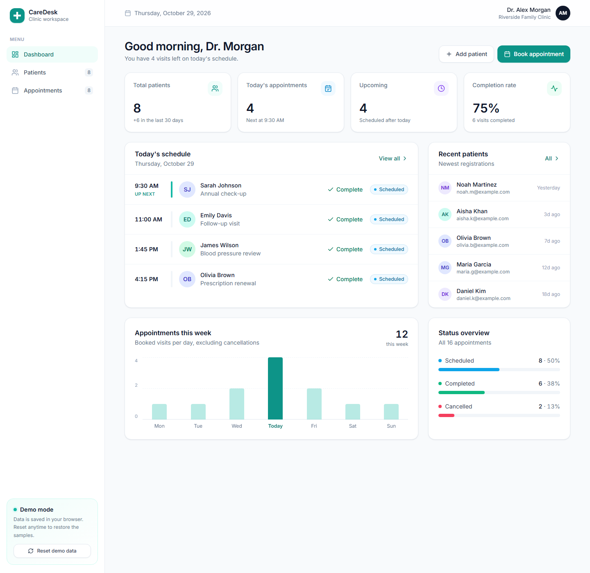

# CareDesk

A clean, responsive clinic management dashboard for tracking patients and appointments, built with React, TypeScript and Tailwind CSS.

**Live demo:** _add your Vercel URL here_



## Features

- **Dashboard:** personalised greeting, KPI cards (patients, today's visits, upcoming, completion rate), today's schedule with an "up next" marker, recent patients, a weekly appointments chart and a status overview
- **Patients:** searchable directory with avatars, age, completed-visit count and next appointment; add patients, book a visit for a patient or remove them
- **Appointments:** grouped by day (Today, Tomorrow, …), status filters with live counts, search, and one-click complete or cancel
- **Polished UX:** modal forms with quick-pick visit reasons, toast notifications, helpful empty states, and a sidebar that collapses into a drawer on mobile
- **No backend needed:** data persists in localStorage, and the sample data is generated relative to today so the demo always looks current. "Reset demo data" restores it

## Tech stack

React 18 · TypeScript · Vite · Tailwind CSS · React Router. No UI or icon libraries; every component is hand-built.

## Run locally

```bash
npm install
npm run dev
```

## Deploy

Import the repo on [Vercel](https://vercel.com). The defaults (Vite, `npm run build`, output `dist`) work as-is, and `vercel.json` handles client-side routing.
